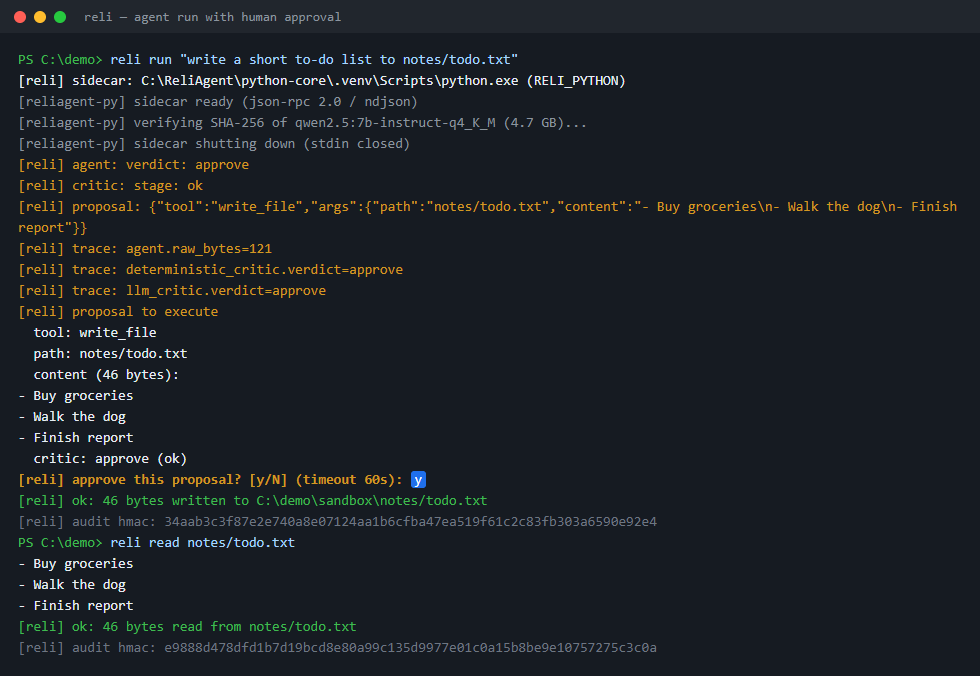
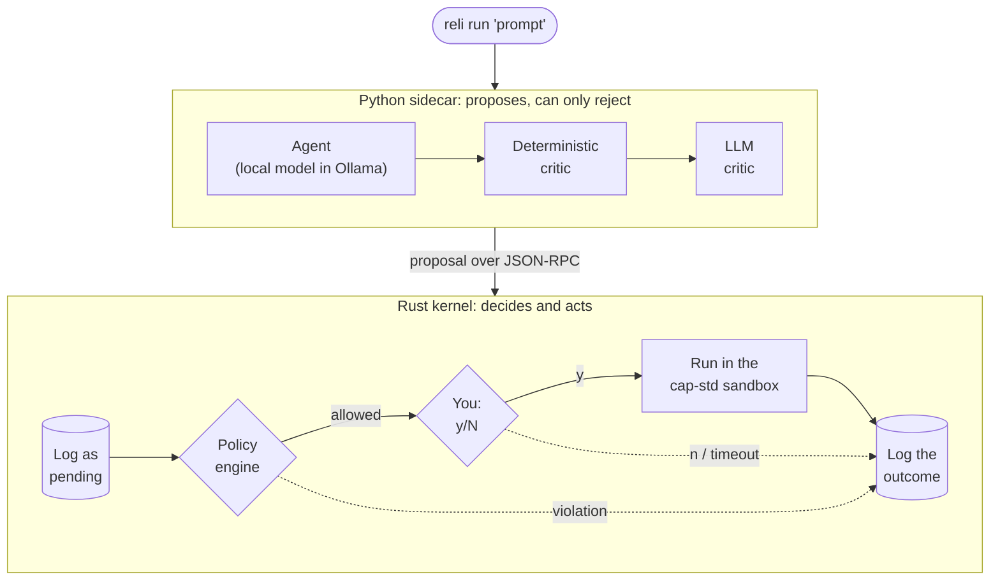
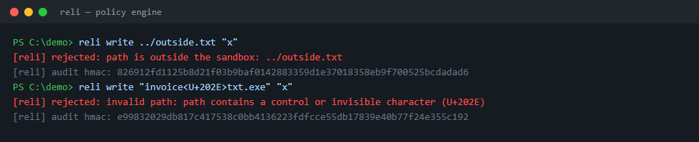
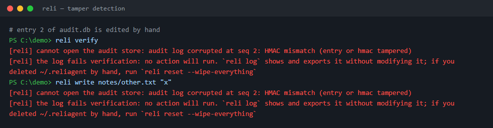

<div align="center">

# ReliAgent

**A policy and audit kernel for local AI agents.**

The model proposes. Deterministic rules decide. You approve.<br>
Every step lands in a tamper-evident log, and ReliAgent itself never touches the network.

[](https://github.com/neomikhe/ReliAgent/actions/workflows/test.yml)
[](LICENSE)


[Quick start](#quick-start) · [How it works](#how-it-works) · [Install](#install) · [Commands](#command-reference) · [Security](#security-model-in-brief) · [Threat model](docs/THREAT_MODEL.md)



<sub>A real session on Windows: the proposal is shown in full, and nothing is written until you type <code>y</code>.</sub>

</div>

> [!IMPORTANT]
> **Research Preview (v0.1.0).** The design is stable enough to try and to
> attack; it is not production software. Read
> [`docs/THREAT_MODEL.md`](docs/THREAT_MODEL.md) before relying on it.

## Contents

- [Why ReliAgent](#why-reliagent)
- [Highlights](#highlights)
- [How it works](#how-it-works)
- [See it in action](#see-it-in-action)
- [Quick start](#quick-start)
- [Install](#install)
- [Using `reli`](#using-reli)
- [Command reference](#command-reference)
- [Security model in brief](#security-model-in-brief)
- [Status and roadmap](#status-and-roadmap)
- [Project layout](#project-layout)
- [Documentation](#documentation)
- [Contributing](#contributing)
- [Licence](#licence)

## Why ReliAgent

Many local agent setups hand the model a shell or direct file access.
That has three consequences:

- **A model's mistake becomes a real action.** A hallucinated or injected
  command runs with your permissions.
- **Prompt injection goes unnoticed.** Text inside a file the agent reads
  can steer it, and nothing in the loop pushes back.
- **There is no trustworthy record.** When something goes wrong, nobody
  can show what was proposed, what was approved and what actually ran.

ReliAgent puts a small Rust kernel between the model and your files, so
that every action is proposed, recorded, checked, approved and only then
executed.

## Highlights

- **The model only proposes.** A local LLM suggests one tool call
  (`write_file`, `read_file`, `list_dir`); it never touches the file
  system itself.
- **Deterministic rules decide.** A Rust policy engine confines every
  path to a sandbox (`cap-std` capabilities, no traversal, no absolute or
  device paths, no control or invisible characters) and caps file size.
  Two critics can veto a proposal; nothing can override the rules.
- **You approve.** Agent proposals wait for your `y` on the terminal; a
  timeout or a missing terminal means *reject*.
- **Logged before it runs.** Every action is written to a SQLite audit
  log as `pending` before the policy check, the prompt or any file access,
  then resolved as `ok`, `rejected` or `error`. Entries are HMAC-SHA256
  chained with a key in the OS keyring, and the last entry is also
  witnessed in the keyring, so edits, deletions and truncation are
  detected (`reli verify`).
- **Read-only when tampered.** A log that fails verification stops every
  action; `reli log` still exports it, without changing a byte.
- **No network from ReliAgent.** The Rust binary makes no outbound calls;
  the Python sidecar talks only to `127.0.0.1:11434` and verifies the
  pinned model's SHA-256 before every run.
- **Verifiable releases.** Self-contained archives (binary + pinned Python
  runtime), signed with cosign, with build provenance and SBOMs.

## How it works



1. `reli run "<prompt>"` starts the Python sidecar (stdlib only, JSON-RPC
   over stdin/stdout, isolated mode `python -I`).
2. The sidecar checks that Ollama is local, has the pinned model and that
   the weights on disk match [`MODEL_SHA256.txt`](MODEL_SHA256.txt); then
   the agent proposes a tool call and both critics review it.
3. The Rust kernel logs the proposal as `pending` (committed with
   `synchronous = FULL`). If that fails, nothing runs.
4. The policy engine validates it; a violation is logged as `rejected`
   and you are not even asked.
5. You approve or reject on the terminal (60 s timeout).
6. The action runs inside the sandbox and its outcome is logged as a
   second entry linked to the `pending` one.

You trust `reli`, its bundled `python/` folder, your OS account and its
keyring. The log does **not** cover what files contain now (an antivirus
or you can change them later), proposals the critics already rejected
(they never reach the kernel), or anything after someone ran code as you.

## See it in action

**The policy engine decides before anyone is asked.** Leaving the sandbox,
or hiding an invisible character (here U+202E, which can make
`invoice<U+202E>txt.exe` look like `invoiceexe.txt`) in a file name, is
rejected before the disk is touched, and the refusal is logged too.



**Tampering is detected, and the kernel stops acting.** After one row of
`audit.db` is edited by hand, `reli verify` reports the entry where the
HMAC chain breaks, and every command that would act refuses to run.



<details>
<summary>Plain-text transcript (excerpt of the same session, paths shortened)</summary>

```text
$ reli write notes/hello.txt "Hello from ReliAgent"
[reli] ok: 20 bytes written to C:\demo\sandbox\notes/hello.txt
[reli] audit hmac: d7f1b7847787c3c2289faa8442b56d48f22241e080a48a43a126d1556699d821

$ reli write ../outside.txt "x"
[reli] rejected: path is outside the sandbox: ../outside.txt
[reli] audit hmac: 826912fd1125b8d21f03b9baf0142883359d1e37018358eb9f700525bcdadad6

$ reli run "write a short to-do list to notes/todo.txt"
[reliagent-py] verifying SHA-256 of qwen2.5:7b-instruct-q4_K_M (4.7 GB)...
[reli] proposal: {"tool":"write_file","args":{"path":"notes/todo.txt","content":"- Buy groceries\n- Walk the dog\n- Finish report"}}
[reli] trace: deterministic_critic.verdict=approve
[reli] trace: llm_critic.verdict=approve
[reli] proposal to execute
  tool: write_file
  path: notes/todo.txt
  content (46 bytes):
- Buy groceries
- Walk the dog
- Finish report
  critic: approve (ok)
[reli] approve this proposal? [y/N] (timeout 60s): y
[reli] ok: 46 bytes written to C:\demo\sandbox\notes/todo.txt
[reli] audit hmac: 34aab3c3f87e2e740a8e07124aa1b6cfba47ea519f61c2c83fb303a6590e92e4

$ reli verify
[reli] verify ok: 16 entries, last hmac e9888d478dfd1b7d19bcd8e80a99c135d9977e01c0a15b8be9e10757275c3c0a

# someone edits one row of audit.db by hand…
$ reli verify
[reli] cannot open the audit store: audit log corrupted at seq 2: HMAC mismatch (entry or hmac tampered)
[reli] the log fails verification: no action will run. `reli log` shows and exports it without modifying it; if you deleted ~/.reliagent by hand, run `reli reset --wipe-everything`
```

</details>

## Quick start

**No model needed:** try the whole pipeline with the deterministic test
agent (from a release folder, or a source build as below):

```bash
./reli ping
./reli run --mock-llm "write 'hello' to notes/hi.txt"     # answer y to approve
./reli verify
```

**With the real model:** install [Ollama](https://ollama.com/), then:

```bash
ollama pull qwen2.5:7b-instruct-q4_K_M        # ~4.7 GB, once
OLLAMA_NO_CLOUD=1 ollama serve                # see "Ollama" below
./reli run "create a file called notes.txt with a to-do list"
```

## Install

| Component | Requirement |
|---|---|
| Operating system | Linux x86-64, macOS on Apple Silicon or Windows x86-64 (release builds); other targets from source |
| Model runtime | [Ollama](https://ollama.com/) on `127.0.0.1:11434` with `qwen2.5:7b-instruct-q4_K_M` (~4.7 GB); not needed for `--mock-llm` or the tests |
| Keyring | Windows Credential Manager, macOS Keychain, or a Secret Service on Linux (gnome-keyring, KeePassXC, KWallet) |
| From source only | Rust 1.99.1 (installed by `rustup`), Python 3.12 with [`uv`](https://github.com/astral-sh/uv) |

### Ollama

Real inference needs an Ollama listening on `127.0.0.1:11434` with the
pinned model pulled (tests and `--mock-llm` work without it):

```bash
ollama pull qwen2.5:7b-instruct-q4_K_M   # ~4.7 GB
```

Run Ollama with `OLLAMA_NO_CLOUD=1`. Without it, Ollama contacts
`ollama.com` on its own at start-up and every few hours (model
recommendations, cloud catalogue); ReliAgent needs none of that. Details
in [`audits/ollama_v0.31.2.md`](audits/ollama_v0.31.2.md).

```bash
OLLAMA_NO_CLOUD=1 ollama serve                 # Linux / macOS
$env:OLLAMA_NO_CLOUD = "1"; ollama serve       # Windows PowerShell
```

For the desktop app, set `OLLAMA_NO_CLOUD=1` as a user environment
variable and restart the app; for the Linux systemd service, run
`sudo systemctl edit ollama` and add `Environment=OLLAMA_NO_CLOUD=1`
under `[Service]`.

### From a release

Each release archive is self-contained: the `reli` binary, a pinned
[python-build-standalone](https://github.com/astral-sh/python-build-standalone)
runtime in `python/` (SHA-256 in [`scripts/pbs.lock`](scripts/pbs.lock))
with the sidecar installed, and the docs. No system Python is needed.

1. From <https://github.com/neomikhe/ReliAgent/releases>, download your
   platform's archive **and** its `.cert` and `.sig` files:
   `reli-v0.1.0-linux-x86_64.tar.gz`, `reli-v0.1.0-macos-aarch64.tar.gz`
   (Apple Silicon) or `reli-v0.1.0-windows-x86_64.zip`. There is no Intel
   Mac or ARM Linux build in v0.1.0: build from source there.
2. Verify it (needs [cosign](https://github.com/sigstore/cosign) and a
   signed-in [`gh`](https://cli.github.com/)), then extract and run:

```bash
A=reli-v0.1.0-linux-x86_64.tar.gz
cosign verify-blob --certificate "$A.cert" --signature "$A.sig" \
    --certificate-identity "https://github.com/neomikhe/ReliAgent/.github/workflows/release.yml@refs/tags/v0.1.0" \
    --certificate-oidc-issuer https://token.actions.githubusercontent.com "$A"
gh attestation verify "$A" --repo neomikhe/ReliAgent \
    --signer-workflow neomikhe/ReliAgent/.github/workflows/release.yml

tar -xzf "$A"                                  # or unzip the Windows .zip
cd reli-v0.1.0-linux-x86_64
./reli ping                                    # finds ./python by itself
```

Keep `python/` next to `reli` (that is where `reli` looks for it), and
extract as the user who will run it into a directory only that user can
write: `reli` trusts that folder (see [KNOWN_ISSUES.md](KNOWN_ISSUES.md)).
On Linux, `reli` needs `libdbus-1.so.3` and a running Secret Service
(gnome-keyring, KeePassXC, KWallet) for the OS keyring; desktop
distributions have both, minimal containers may not.

### From source

Requirements: Rust **1.99.1** (pinned in
[`rust-toolchain.toml`](rust-toolchain.toml), installed automatically by
`rustup`) and Python **3.12** with [`uv`](https://github.com/astral-sh/uv).
On Linux, also the D-Bus headers and `pkg-config`
(`sudo apt-get install libdbus-1-dev pkg-config` on Debian/Ubuntu,
`dbus-devel pkgconf` on Fedora).

```bash
git clone https://github.com/neomikhe/ReliAgent.git
cd ReliAgent

# Rust side
cargo build --release

# Python sidecar: `uv sync` creates python-core/.venv with the package installed
(cd python-core && uv sync --extra dev)

# Tell reli which interpreter runs the sidecar
export RELI_PYTHON="$PWD/python-core/.venv/bin/python"      # Windows: python-core\.venv\Scripts\python.exe

# Smoke tests
cargo test
(cd python-core && uv run pytest)
./target/release/reli ping
```

`cargo test` starts real Python processes: it needs `python3` (`python`
on Windows) on `PATH`. If that is missing or is the Microsoft Store alias,
set `RELI_TEST_PYTHON` to the venv interpreter (see
[CONTRIBUTING.md](CONTRIBUTING.md)).

`reli` looks for the sidecar interpreter in this order: `--python <path>`,
`$RELI_PYTHON`, `python/` next to the `reli` executable (release layout),
then `python3` (`python` on Windows) from `PATH`. It starts it in isolated
mode (`python -I`), so that interpreter must have `reliagent_python`
installed. To build a release-style directory locally, see
[`scripts/README.md`](scripts/README.md).

## Using `reli`

The examples use `./reli` from a release folder; with a source build, use
`./target/release/reli` (and `RELI_PYTHON` set as above).

### Ask the agent

```bash
./reli sandbox path        # where the agent may work (~/ReliAgent_Sandbox)
./reli run "create a file called notes.txt with a to-do list"
```

Before the first inference, `reli run` checks that Ollama is reachable,
that it has the pinned model, and that the model file on disk matches the
SHA-256 in [`MODEL_SHA256.txt`](MODEL_SHA256.txt). If any check fails it
stops and tells you what to do (start Ollama, `ollama pull ...`, or
re-download a model that does not match).

`reli run` shows the exact action it is about to take and asks
`approve this proposal? [y/N]` before any side effect. `y` or `yes`
approves (`s` and `si` are accepted too); anything else, letting the
prompt time out (60 s), or running with `--non-interactive` rejects the
proposal. `--dry-run` only shows the proposal; `--mock-llm` uses the
deterministic test agent (the LLM critic is skipped too), with everything
after it unchanged.

> [!WARNING]
> **`--sandbox` is the jail.** The agent can read and write anything
> under it, and `reli reset --wipe-everything` deletes everything inside
> it. Never point `--sandbox` at a directory that holds anything else.

### Direct commands

`reli write <path> <content>`, `reli read <path>` and `reli ls [path]`
act inside the sandbox without asking: typing the command is your
approval. They are policy-checked and logged exactly like an agent
proposal. On a terminal, `reli read` escapes control characters and ends
the last line, so the status message starts on its own line; redirect it
to get the exact bytes.

### Verify and export the log

```bash
./reli verify
./reli log > audit-export.jsonl
```

`verify` walks the HMAC chain and cross-checks it against the anchor log
and the head witness kept in the OS keyring. A successful verification
prints the number of entries, the most recent HMAC and any action still
waiting for its outcome. A failure prints the sequence number where
tampering was detected, and from then on `reli` stays in **read-only
mode**: every command that would act refuses to run (exit code `3`) until
the log verifies again or you run `reli reset --wipe-everything`, and
nothing is repaired for you.

`log` prints every entry exactly as it is stored, one JSON object per
line, and then reports on stderr whether the log verifies (exit `0`) or
where it breaks (exit `3`). It works on a healthy log too, and it never
modifies the log: it reads through a read-only SQLite connection, never
migrates, and creates no key, anchor or witness. Control and invisible
characters are written as JSON escapes, so the export is safe to `cat`
or `grep` in a terminal. If the database holds anything `reli` never
creates (a view, a trigger, an extra column) it refuses to export and
asks you to analyse a copy. The byte-level format is in
[`docs/HASH_FORMAT.md`](docs/HASH_FORMAT.md).

Each action appears as two entries: `pending` (written before the policy
check, approval and execution) and its outcome. If `reli` is killed
between the two, the next run records the leftover `pending` as
`abandoned` ("may or may not have run") and names it on the terminal.
Only one `reli` process can use the log at a time; a second one waits
about 2 s and exits with code `6` (busy, not tampering).

### Start over

```bash
# Wipes the sandbox, audit DB, anchors and the keyring entries (HMAC key
# and head witness). Irreversible. Use this instead of deleting
# ~/.reliagent by hand, which would look like tampering.
./reli reset --wipe-everything
```

All audit logs on the machine share one HMAC key, and `reset` deletes
it: if you use several `--audit-dir` values, every *other* log stops
verifying afterwards. Export them with `reli log` first.

## Command reference

| Command | What it does | Exit codes |
|---|---|---|
| `reli run "<prompt>"` | Sends `<prompt>` to the Python sidecar, verifies Ollama and the pinned model, runs the agent/critic loop, gates every proposed tool call on the policy engine + TTY. `--dry-run` only shows the proposal; `--mock-llm` uses the deterministic test agent instead of Ollama. | `0` ok, `1` rejected, `2` bad input, `3` audit, `4` bridge / Ollama / model check, `5` timeout, `6` log in use |
| `reli write <path> <content>` / `reli read <path>` / `reli ls [path]` | Direct actions inside the sandbox: logged and policy-checked like an agent proposal, but **not prompted** (typing the command is your approval). | `0` ok, `1` policy, `2` bad input or I/O, `3` audit, `6` log in use |
| `reli verify` | Re-runs the HMAC chain, anchor and head-witness checks over the whole audit DB. | `0` clean, `3` corrupted, `6` log in use |
| `reli log` | Read-only: prints every audit entry as JSON Lines (invisible and control characters escaped), then the verification result. Also works on a log that fails verification. | `0` clean (or no log yet), `2` output could not be written, `3` corrupted or not verifiable, `6` log in use |
| `reli sandbox path` | Prints the sandbox root. | `0` |
| `reli sandbox status` | Prints sandbox path, audit entry count, last HMAC, keyring label, open actions. | `0` / `3` log fails verification or keyring unreadable / `6` |
| `reli reset --wipe-everything` | Wipes sandbox, audit DB (and its migration backup), anchors, and the keyring entries (including the HMAC key shared by every log). Asks you to type `WIPE` unless `--force`; refuses while another `reli` uses the log. | `0` / `1` aborted / `2` no `--wipe-everything` / `3` partial failure / `6` |
| `reli ping` | Pings the Python sidecar to confirm the bridge is alive. | `0` / `4` |

Global flags: `--sandbox <dir>` (default `~/ReliAgent_Sandbox`),
`--audit-dir <dir>` (default `~/.reliagent`), `--python <path>`,
`--python-cwd <dir>`, and `--non-interactive`, which turns every approval
prompt into an auto-reject (use it in CI and scripts). `reli --help` and
`reli <command> --help` describe each of them.

## Security model in brief

| Protects against | Does not protect against |
|---|---|
| An LLM (or a prompt injection) proposing writes or reads outside the sandbox | Code running as your user account: it can read the keyring and rewrite the log |
| Deceptive file names (control, bidi, zero-width, tag characters) | Look-alike letters from other scripts, Unicode normalisation variants |
| Editing, deleting or truncating the audit log, or planting triggers, views or extra columns in it | Rolling back the OS credential store together with the log (Windows) |
| Acting without a log entry (power loss, crash, log failure) | Changes to files after the action (the log records actions, not file contents) |
| A swapped or tampered model file | Ollama's own network traffic, unless you set `OLLAMA_NO_CLOUD=1` |
| Another account modifying the bundled Python runtime (Linux/macOS) | Another account writing to the release folder on Windows (no ACL check) |

The full analysis, with every vector and residual risk, is in
[`docs/THREAT_MODEL.md`](docs/THREAT_MODEL.md); dependencies are checked
against public advisory databases before every release
([`docs/RELEASING.md`](docs/RELEASING.md)). Report vulnerabilities
privately as described in [`SECURITY.md`](SECURITY.md).

## Status and roadmap

| Area | Status |
|---|---|
| Rust kernel (policy engine, sandbox, HMAC chain) | Implemented, 200+ unit tests + property tests. |
| CLI (`reli run / write / read / ls / verify / log / sandbox / reset / ping`) | Implemented. |
| Python sidecar (orchestrator + critic + Ollama client) | Implemented. Stdlib-only, no runtime dependencies. Tested against a local fake Ollama server and against Ollama 0.31.2, whose network behaviour is audited in [`audits/`](audits/) (run it with `OLLAMA_NO_CLOUD=1`). |
| Model pinning (`qwen2.5:7b-instruct-q4_K_M`) | Weights SHA-256 pinned and re-checked on every `reli run`. |
| Red-team suite (27 vectors) | [`tests/red_team.rs`](tests/red_team.rs): 23 run (some only on the platform they target); 4 are pinned as ignored until the feature they test exists: session quota and `grant_scope` (v0.2), byte-exact JCS (next hash format). |
| CI | Every pull request and every push to `main`: fmt, clippy and all tests on Linux, macOS and Windows, plus the Python suite ([`test.yml`](.github/workflows/test.yml)). CodeQL and Dependabot for crates, Python and actions. |
| Self-contained release (binary + pinned python-build-standalone runtime + sidecar) | Implemented: `scripts/package_release.sh`, built, smoke-tested, signed and attested per platform by the release workflow. |
| Tauri GUI | Not in v0.1. Planned for v0.2 or later. |
| `grant_scope` / read allowlist / session quotas | Planned for v0.2. |
| `execute_code` (WASI / RustPython) | Planned for v0.3. |

See [`KNOWN_ISSUES.md`](KNOWN_ISSUES.md) for platform-specific caveats
and the full list of v0.1 limitations, and [`CHANGELOG.md`](CHANGELOG.md)
for what each release changed.

## Project layout

```
ReliAgent/
├── src/                    # Rust crate
│   ├── main.rs
│   ├── cli.rs              # commands, output sanitising, interpreter choice
│   ├── approval.rs         # TTY gate + 60 s timeout
│   ├── bridge/             # JSON-RPC over stdin/stdout to Python
│   └── kernel/
│       ├── policy.rs       # validate_write_path, size caps, unsafe characters
│       ├── sandbox.rs      # cap-std capability root
│       ├── tools.rs        # write_file / read_file / list_dir
│       ├── audit.rs        # AuditEntry, HMAC chain
│       ├── store.rs        # SQLite persistence, schema checks, reli log reader
│       ├── anchor.rs       # rotating JSONL witness log
│       ├── head.rs         # head witness (last entry, kept in the keyring)
│       ├── keyring.rs      # OS keyring binding
│       └── migrations/     # v1.sql, v2.sql
├── python-core/            # Python sidecar (uv, uv_build backend)
│   └── src/reliagent_python/
│       ├── orchestrator.py
│       ├── critic.py
│       ├── llm_client.py   # client protocol + deterministic mock
│       ├── ollama_http.py  # stdlib HTTP client, loopback-only
│       ├── model_integrity.py  # pinned model SHA-256 check
│       ├── main.py         # JSON-RPC server over stdin/stdout (NDJSON)
│       └── __main__.py     # entry point for `python -I -m reliagent_python`
├── tests/
│   ├── bridge_jsonrpc.rs   # cross-process bridge integration
│   └── red_team.rs         # 27 adversarial vectors
├── docs/
│   ├── THREAT_MODEL.md
│   ├── HASH_FORMAT.md
│   ├── RELEASING.md        # maintainer release checklist
│   └── screenshots/        # images used in this README
├── audits/                 # network audits of each targeted Ollama version
├── scripts/                # release packaging (pinned Python runtime)
└── .github/                # test.yml (CI), release.yml (cosign + SBOM), Dependabot
```

## Documentation

| File | When to read it |
|---|---|
| [`docs/THREAT_MODEL.md`](docs/THREAT_MODEL.md) | Before trusting any security claim. |
| [`KNOWN_ISSUES.md`](KNOWN_ISSUES.md) | Before filing a bug, and for platform caveats. |
| [`docs/HASH_FORMAT.md`](docs/HASH_FORMAT.md) | If you want to write an independent log verifier. |
| [`audits/`](audits/) | To see what the targeted Ollama version connects to, and how to turn it off. |
| [`CHANGELOG.md`](CHANGELOG.md) | To see what changed in each release. |
| [`SECURITY.md`](SECURITY.md) | Before reporting a vulnerability. |
| [`CONTRIBUTING.md`](CONTRIBUTING.md) | Before opening a PR. |
| [`docs/RELEASING.md`](docs/RELEASING.md) | If you maintain releases. |
| [`CODE_OF_CONDUCT.md`](CODE_OF_CONDUCT.md) | Before interacting with the community. |

## Contributing

Bug reports and red-team vectors are the most useful contribution right
now: adversarial paths, canonicalisation edge cases, unusual file
systems, platform-specific surprises; exactly what a Research Preview
is for. See [`CONTRIBUTING.md`](CONTRIBUTING.md). Security issues go
through [`SECURITY.md`](SECURITY.md), never a public issue.

## Licence

[Apache License 2.0](LICENSE). See the `LICENSE` file for the full text.

Third-party components you install separately have their own licences:

- Qwen2.5-7B-Instruct weights: [Apache 2.0](https://huggingface.co/Qwen/Qwen2.5-7B-Instruct/blob/main/LICENSE)
  (other Qwen2.5 sizes use different licences).
- Ollama: [MIT](https://github.com/ollama/ollama/blob/main/LICENSE).

You accept each of them independently of ReliAgent.
